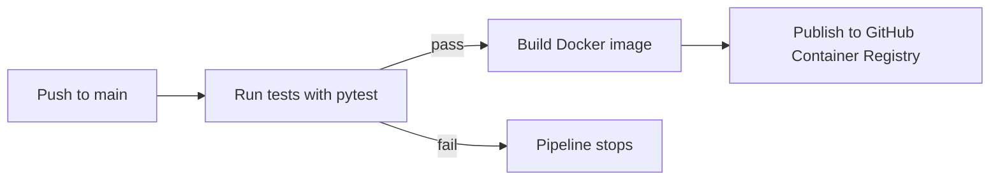

# Flask CI/CD Pipeline


A small Flask web app with a fully automated CI/CD pipeline. Every push to `main` is tested, packaged into a Docker image and published to GitHub Container Registry, with no manual steps.

## How the pipeline works



1. **Test:** GitHub Actions installs the dependencies and runs the pytest suite.
2. **Build:** if the tests pass, the app is packaged with its Dockerfile.
3. **Publish:** the image is pushed to `ghcr.io`, tagged `latest` and with the commit SHA, so every image can be traced to the code that produced it.

Pull requests run the tests only. Nothing is published from them.

## Tech stack

- Python and Flask
- Docker
- GitHub Actions
- GitHub Container Registry
- pytest and gunicorn

## Run it locally

```bash
git clone https://github.com/MohamedHabiba99/flask-cicd-pipeline.git
cd flask-cicd-pipeline
docker build -t flask-cicd .
docker run -p 5000:5000 flask-cicd
```

Then open `http://localhost:5000/health`. You should see `{"status":"ok"}`.

## Run the tests

```bash
pip install -r requirements.txt
python -m pytest
```

## What I learned

- How to write a multi-job GitHub Actions workflow where one job depends on another
- How Docker layers and caching work, and why dependencies are installed before the code is copied
- How to publish images to a container registry without storing any passwords, using the built-in `GITHUB_TOKEN`